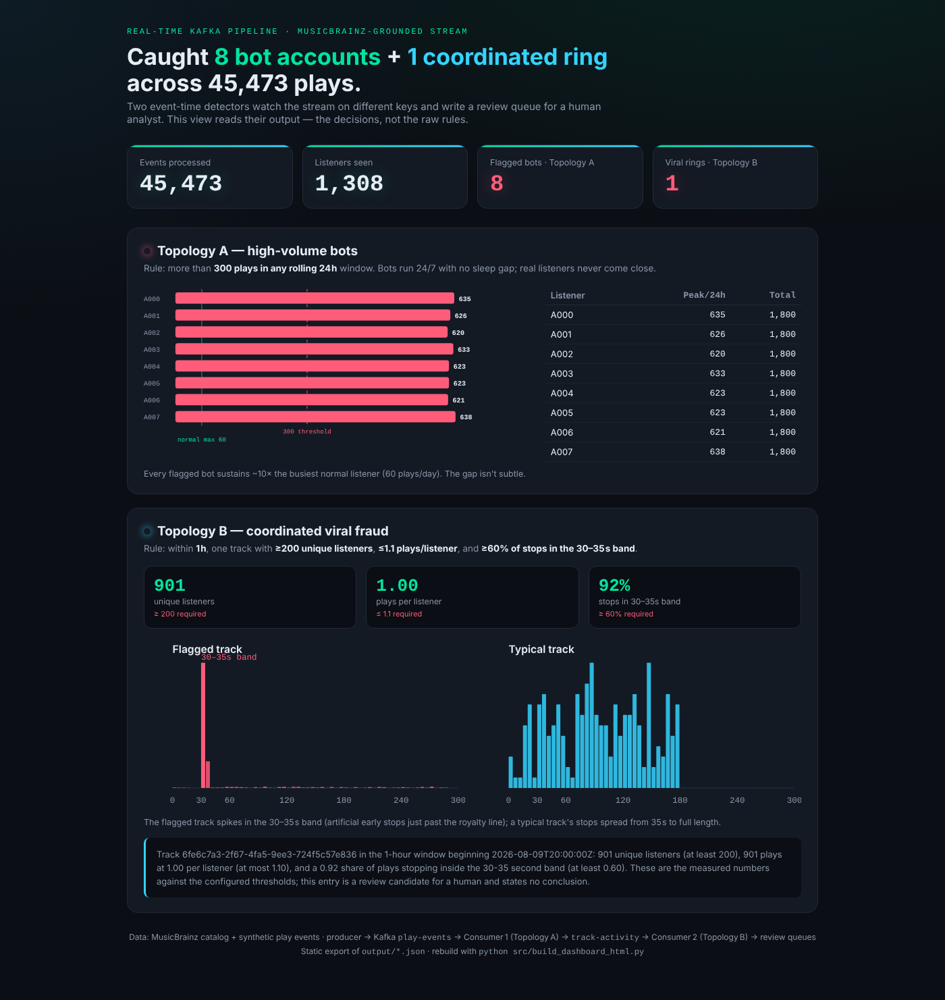

<p align="center">
  
</p>

# Streaming Fraud Detection

Real-time detection of artificial streaming on a music platform, built on Kafka.

Play events flow through two keyed consumer stages that each watch the stream from a different angle. Stage 1 asks whether an account behaves like a person. Stage 2 asks whether a track's audience makes sense. Every flag is written to a review queue with the measured numbers and the thresholds behind it, so a human analyst makes the final call with the evidence in front of them. An optional graph layer on ArangoDB then finds the coordination structure that per-key counting cannot see.

<p align="left">
  
  
  
  
  
  
  
</p>

## What it catches

Two fraud patterns with opposite shapes. That is the reason the pipeline uses two partition keys: each pattern is only visible when the stream is partitioned the right way.

| Pattern | What it looks like | Detected by | Rule (all values from `config/thresholds.json`) |
|---|---|---|---|
| **High-volume bots** | A handful of accounts streaming around the clock, spread thin across the catalog | Stage 1, keyed by `listener_id` | More than 300 plays in any rolling 24-hour event-time window |
| **Coordinated plays** | Hundreds of accounts that each play one track exactly once and stop just past the 30-second royalty line | Stage 2, keyed by `track_id` | In one event-time hour: at least 200 unique listeners, at most 1.1 plays per listener, at least 60% of stops in the 30 to 35 s band |

**Results on the shipped 45,473-event stream** (1,308 listeners, 464 tracks, 23,302 track-hour buckets):

- **8 flagged accounts**, each peaking between 620 and 638 plays in a rolling 24-hour window. None of the 400 normal listeners was flagged.
- **1 flagged track window**: 901 unique listeners, exactly 1.00 plays each, 92% of stops inside the 30 to 35 s band.
- **0 dropped, 0 duplicated, 0 key mismatches** across both stages.
- Neither key finds both patterns. `tests/test_two_key_proof.py` asserts this end to end through a live broker rather than stating it.

## Architecture

```
MusicBrainz catalog (real recording and artist IDs, cached once)
        │
        ▼
generate_events.py ──► play_events.jsonl ──► replay_to_kafka.py
(seeded, contract-validated, byte-identical for a given seed)       │
                                                                    ▼
                                             topic  play-events   (key = listener_id, 3 partitions)
                                                                    │
                                                                    ▼
                                             consumer_stage1.py   rolling 24 h rule per listener
                                             dedup journal, checkpointed offsets, re-key by track_id
                                                                    │
                                                                    ▼
                                             topic  track-activity  (key = track_id)
                                                                    │
                                 ┌──────────────────────────────────┴──────────────────────────┐
                                 ▼                                                             ▼
                      consumer_stage2.py                                             graph_emitter.py
                      three-condition rule per track-hour                            graph-listeners / graph-tracks / graph-played
                                 │                                                             ▼
                                 ▼                                             ArangoDB  (python-arango loader, or Kafka Connect sink)
                      output/listener_review_queue.json                                        ▼
                      output/track_review_queue.json                                 graph_queries.py ──► output/cohort_report.json
                                 │
                                 ▼
                      dashboard.py (Streamlit)  ·  build_dashboard_html.py (static)  ·  summarize_review_queue.py (bounded LLM notes)
```

**Design principles**

- **One contract, imported by every stage.** `contracts/play_event_v1.py` (Pydantic v2) is the single source of truth for the event schema. The producer rejects invalid events before they reach the broker; the consumers drop and count anything that slips through.
- **Event time, never wall-clock time.** Windows are computed from `event_time`. A test scans the AST of the windowing module and fails if anything reads the system clock.
- **Safe to kill and restart.** Stage 1 journals every forwarded `event_id` and deduplicates against it across runs. The end-to-end test kills the consumer mid-run and restarts it: nothing lost, nothing forwarded twice.
- **Configuration, not constants.** Every detection threshold is loaded from `config/thresholds.json`. No detector carries a built-in default, and a test proves it.
- **Review candidates, not verdicts.** Each flagged entry carries the measured values, the thresholds, the comparison, and the config file they came from. No output in this repository concludes that fraud occurred; a false positive withholds money from a real artist, so that judgment stays with a person.
- **Nothing beyond the broker is required.** The graph layer and the Connect worker sit behind a Docker Compose profile. A plain `docker compose up -d` starts exactly the broker and its console.

## Quick start

Requirements: Python 3.11+, Docker. No API keys, no cloud account.

```bash
pip install -r requirements.txt

# 1. Broker (Redpanda) and its web console on http://localhost:8080
docker compose up -d
docker compose ps                      # wait for redpanda to report "healthy"

# 2. Topics: 3 partitions each, write caching off (safe to re-run)
python3 src/create_topics.py

# 3. Start clean. The dedup journal in state/ survives a broker wipe by design,
#    so always clear it when you start over.
rm -rf state output

# 4. Replay the full stream and run both stages
python3 src/replay_to_kafka.py
python3 src/consumer_stage1.py --thresholds config/thresholds.json --commit-every 200
python3 src/consumer_stage2.py --thresholds config/thresholds.json --commit-every 200
```

Stage 2 prints the terminal report and both review queues land in `output/`. The consumers exit after 10 seconds with no new records, so the end of a run looks like a short pause first.

Measured on a 2024 MacBook Pro: the replay of all 45,473 events takes under one second, and each stage processes the full stream in about two seconds of work.

For a smoke test, add `--limit 500` to the replay. It flags nothing (500 events is far below any threshold) but proves the broker, topics, contract validation, re-key, and both consumers are wired up.

## Outputs

| File | Produced by | Contents |
|---|---|---|
| `output/listener_review_queue.json` | Stage 1 | Flagged listeners with peak rolling-24h plays, the threshold, and total plays |
| `output/track_review_queue.json` | Stage 2 | Flagged track-hour windows with the three measured values, each threshold, a `satisfied` flag per condition, run counts, the rule in words, and the thresholds file path |
| `output/cohort_report.json` | Graph layer | The two cohort queries, collection counts, seeds, baseline, and thresholds. Byte-identical across runs over the same graph |

The terminal report at the end of Stage 2:

```
Consumer 2 done. Polled 45473, counted 45473.
  dropped, invalid value : 0
  dropped, key mismatch  : 0
  dropped, duplicate id  : 0
  tracks seen            : 464
  event-time hour buckets: 23302
  flagged windows        : 1
      6fe6c7a3-2f67-4fa5-9ee3-724f5c57e836 @ 2026-08-09T20:00:00Z (1h)
          min_unique_listeners: measured 901, at least 200
          max_plays_per_listener: measured 1.0, at most 1.1
          min_band_share: measured 0.9234184239733629, at least 0.6
  flagged listeners      : 8
      A000: peak 635 plays in 24h, over 300
      ...
```

## Data

A hybrid model, documented in [`DATA_SOURCE.md`](DATA_SOURCE.md):

- **Catalog: real.** 500 tracks and about 57 artists with genuine MusicBrainz recording and artist IDs and durations, fetched once by `src/fetch_musicbrainz_catalog.py` and cached in `data/catalog.json`. The pipeline never calls MusicBrainz at run time.
- **Play events: synthetic.** Real per-user listening logs are private, and no public dataset contains labeled streaming fraud. `src/generate_events.py` produces 45,473 events over three compressed days across three cohorts: 400 normal listeners (10 to 60 plays a day, a sleep gap, a personal track pool), 8 high-volume bot accounts (600 plays a day, around the clock), and 900 single-play accounts converging on one track inside a 45-minute window. The same `--seed` yields a byte-identical file.

```bash
python src/fetch_musicbrainz_catalog.py --contact you@example.com   # once
python src/generate_events.py --seed 7
```

## Configuration

All thresholds live in `config/thresholds.json`. Retuning a rule is a config edit, not a code change.

```json
{
  "topology_a_window_hours": 24,
  "topology_a_plays_over": 300,
  "topology_b_window_hours": 1,
  "topology_b_min_unique_listeners": 200,
  "topology_b_max_plays_per_listener": 1.1,
  "topology_b_min_band_share": 0.6
}
```

`config/thresholds.fixture.json` holds a scaled-down set for the 48-event test fixture.

## Graph layer

The keyed stages answer counting questions. Coordination is a property of relationships, not of any one key, so the graph layer models listeners and tracks as a bipartite graph and asks two questions the stages cannot. Full detail in [`GRAPH.md`](GRAPH.md).

```bash
docker compose --profile graph up -d                            # broker + console + ArangoDB
python3 src/graph_emitter.py --group graph-emitter-full         # track-activity -> 3 graph topics
python3 src/graph_loader.py --drop --group graph-loader-full    # 3 topics -> ArangoDB
python3 src/graph_queries.py                                    # -> output/cohort_report.json
```

At full scale: 1,308 listener vertices, 464 track vertices, 45,473 `played` edges, 0 dangling endpoints, loaded in about twelve seconds. Writes are upserts keyed on natural ids, so a replay leaves the graph unchanged; this is proven by loading twice and diffing the graph state.

- **Co-listening overlap.** Seeded on a flagged listener, it finds the 7 peers that share 438 to 446 distinct tracks with the seed. The highest overlap outside that group is 25; the normal-listener baseline is a mean of 1.24. The separation is a property of the data, not of the threshold.
- **Fan-in with no other activity.** From the flagged track, 928 inbound listeners, of which exactly 900 have one play and one distinct track in the entire graph.

Both seeds are read from the review-queue artifacts, never hard-coded, so the graph layer and the keyed pipeline cannot disagree about what was flagged.

**Kafka Connect sink.** ArangoDB's own Kafka Connect connector consumes the same three topics and writes a second database. It produced identical counts and identical query results to the direct loader, which is the acceptance test; a connector reporting `RUNNING` while writing nothing is the failure mode it guards against. Setup and provenance in [`connect/README.md`](connect/README.md).

## Dashboard

```bash
streamlit run src/dashboard.py          # live view on http://localhost:8501
python src/build_dashboard_html.py      # or a self-contained dashboard.html, no server needed
```

Both read the review queues and the event stream and visualize what the detectors decided. They do not re-implement the rules.

## Bounded LLM summary

`src/summarize_review_queue.py` turns the track review queue into at most three reviewer notes. The model call is optional and strictly bounded: it may not change a flag, may not introduce a number that the entry does not contain, and may not use verdict language. A response that violates any bound is rejected whole, and the tool falls back to a deterministic template sentence.

No API key is required. With `OPENAI_API_KEY` unset, no network call is attempted and the template path runs. Every bound is tested against stubbed clients, not live calls.

## Tests

```bash
python3 -m pytest tests/ -q      # 408 tests
```

| Area | What is proven |
|---|---|
| Two-key proof | The listener key finds the bots and misses the coordinated plays; the track key does the reverse. Asserted through a live broker and again against the full-scale artifacts. Two independent replays produce identical detection. |
| Stage 1 | Rolling counts, the re-key (key changes, payload byte-identical), invalid-record drops, the dedup journal, and kill-and-restart recovery against a live 3-partition broker |
| Stage 2 | The three-condition rule, two near-miss decoy windows that each fail on exactly one condition, and an AST scan proving the rolling accumulator is not used here |
| Windowing | Hourly buckets, rolling 24-hour sums, per-key watermarks, late-arrival drops, and an AST scan proving nothing reads the system clock |
| Contract and config | The `PlayEventV1` model and its helpers; no threshold carries a code default |
| Graph layer | Emitter, loader (dangling edges, driver error handling), both queries, and the verdict-language bound on the report |
| LLM summary | All five bounds and all fallback paths, against stubs |

Tests that need a live broker: `test_two_key_proof.py`, `test_consumer_stage1_e2e.py`, `test_consumer_stage2_e2e.py`, `test_harness_roundtrip.py`. Everything else runs with no broker and no network.

## Broker crash test

`acks=all` was not enough. Killing the broker (SIGKILL) partway through a 2,000 events/s replay lost acknowledged events: 15 to 133 per run. The producer reported zero delivery failures every time. The cause is that the Redpanda image runs in developer mode, which acknowledges a write from memory before it reaches disk.

| Setup | Crash runs | Events lost | Duplicates |
|---|---|---|---|
| Before: `acks=all` only | 9 | 15 to 133 in every run | 0 |
| Write caching off only | 9 | 0 | 11 in one run |
| Idempotence only | 7 | producer stops with a fatal error | n/a |
| Both (shipped) | 11 | 0 | 0 |

The fix is two settings:
- `write.caching=false` on both topics, in `src/create_topics.py`.
- `enable.idempotence=true` on the producer, in `src/replay_to_kafka.py`.

What it costs:
- Turning write caching off cost no measurable throughput.
- Idempotence adds a one-time wait of about half a second while the producer obtains its producer id. That takes the full 45,473-event replay from 0.38 s to 0.84 s.

The test ran on a single node with replication factor 1. A 3-replica production topic would usually survive one broker crash anyway. Method, raw results and the harness are in [`bench/BENCHMARK_RESULTS.md`](bench/BENCHMARK_RESULTS.md).

## Repository layout

```
contracts/play_event_v1.py         shared PlayEventV1 model (Pydantic)
src/fetch_musicbrainz_catalog.py   one-time MusicBrainz fetch -> data/catalog.json
src/generate_events.py             seeded event generator (3 cohorts)
src/replay_to_kafka.py             contract-validated replay into play-events
src/consumer_stage1.py             per-listener rule, dedup journal, re-key
src/consumer_stage2.py             per-track rule, review queue, terminal report
src/windowing.py                   event-time buckets and rolling sums
src/config.py                      threshold loading
src/graph_emitter.py               track-activity -> graph topics
src/graph_loader.py                graph topics -> ArangoDB
src/graph_queries.py               cohort queries -> cohort_report.json
src/summarize_review_queue.py      bounded LLM reviewer notes with template fallback
src/dashboard.py                   Streamlit dashboard
src/build_dashboard_html.py        static HTML dashboard
connect/                           Kafka Connect sink configs and setup
bench/                             producer benchmarks and the broker crash test
config/                            detection thresholds
data/                              cached catalog, event stream, manifest
tests/                             408 tests
docker-compose.yml                 Redpanda + console; ArangoDB and Connect behind --profile graph
```

## Further reading

- [`DESIGN-two-key-pipeline.md`](DESIGN-two-key-pipeline.md): why two partition keys, with the production argument
- [`GRAPH.md`](GRAPH.md): the graph layer, replay idempotency, and both cohort queries
- [`connect/README.md`](connect/README.md): the Kafka Connect path and connector provenance
- [`bench/BENCHMARK_RESULTS.md`](bench/BENCHMARK_RESULTS.md): producer throughput, latency, and the broker crash test behind the durability settings
- [`PRODUCER-CONSUMER-CONTRACT.md`](PRODUCER-CONSUMER-CONTRACT.md) and [`CONTRACT-DECISIONS.md`](CONTRACT-DECISIONS.md): the event contract and the decisions behind the thresholds
- [`RESEARCH-artificial-streaming-fraud.md`](RESEARCH-artificial-streaming-fraud.md): the fraud mechanics this design is based on
- [`DEMO.md`](DEMO.md): an end-to-end walkthrough from a wiped broker, with timings

## Authors

Built by Tianyi Luo and P.J. Losiewicz.
